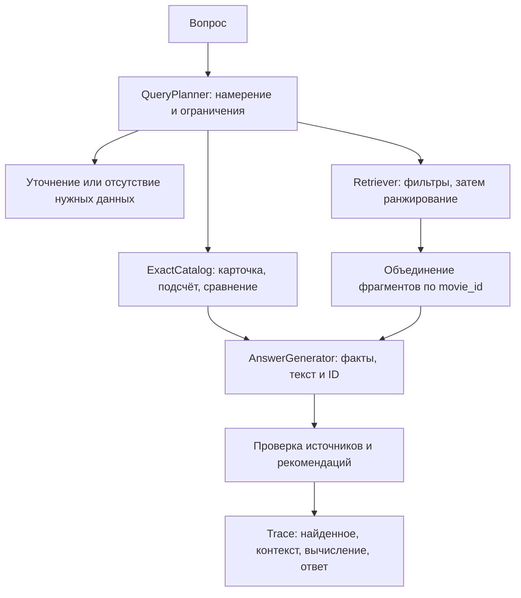

# Архитектура и границы реализации

## Основной поток

`domain.py` не зависит от SDK, сети или интерфейса пользователя. Сервисы
получают реализации протоколов через конструктор/аргументы. Новые провайдеры
размещаются в `adapters/` по мере реализации. Модуль сборки приложения
создаёт клиентов, читает настройки и связывает их с сервисами. CLI, HTTP и
пакетный evaluator должны использовать один `SearchService`.

Для первого рабочего варианта выбран Qdrant. Его адаптер ещё нужно реализовать.
Он должен поддерживать фильтрацию по метаданным и публикацию полного активного
снимка. Использование pgvector потребует других адаптеров `Retriever`,
`IndexWriter` и, при необходимости, `ExactCatalog`; прикладной сценарий остаётся общим.

## Индекс и версии

`index_catalog` выбирает последнюю ревизию каждого `movie_id`, затем учитывает
`active`. Если последняя ревизия неактивна, старая не возвращается в индекс.
При повторной публикации удаляются и лишние части старой версии. Порт
`replace_snapshot` требует атомарной смены снимка: частичная загрузка не должна
становиться доступной поиску. Конкретный механизм реализуется в адаптере.

Короткие описания сохраняются целиком (`WholeSynopsis`). Для длинных текстов
можно подключить смысловой `Chunker`. Каждая часть содержит исходную карточку;
`chunk_id` получает суффикс `:part-N`, а исходный `source_id` не меняется.
Embedding-текст всегда включает название и текст части.

Хранилище сохраняет ID карточки и части, movie_id, версию, active, название,
год, длительность, теги и текст. Векторный индекс дополнительно фиксирует имя
и ревизию embedding-модели, размерность и fingerprint каталога. Изменение
модели требует отдельного индекса и повторной индексации.

## План запроса и точные операции

Планировщик переводит вопрос в типизированный `QueryPlan`. Он не получает
`expected_status`, rubric или эталонные фильтры из `questions.jsonl`.
При отсутствии выбранного фильма «Сколько он длится?» требует уточнения.
Сведения об озвучивании, рейтингах и возрастных ограничениях отсутствуют в
схеме; запрос таких фактов завершается `insufficient`.

«Короче 90» даёт `< 90`, «не больше 90» — `<= 90`. Фильтры передаются
непосредственно поисковому адаптеру. При нарушении контракта сервис выдаёт
ошибку, поскольку удаление неподходящих результатов после top-k не возвращает
потерянных кандидатов. `retrieval_k` управляет числом частей, `context_movies`
— числом разных фильмов в контексте.

Для «Подойдёт ли Коралловая почта, если у меня 90 минут?» нужен
`COMPARE_DURATION`, выбранный movie_id и бюджет 90. Бюджет здесь не фильтр:
карточка с длительностью 96 должна попасть в контекст. `ExactCatalog`
вычисляет разницу 96 − 90 = 6. Для `COUNT` адаптер считает весь подходящий
набор, а не top-k. Нулевой подсчёт может иметь пустой список источников;
его основание — точная операция, сохранённая в трассе.

Для маленького каталога `ExactCatalog` можно реализовать поверх того же
проверенного JSON-снимка. Он обязан использовать ту же ревизию каталога,
что и индекс. Переход на SQL не меняет контракт.

## Ответы и сбои

Модель получает только выбранные карточки и их части, метаданные, источники
и результат точной операции. `validate_answer` проверяет существование ссылок,
названия, принадлежность источников рекомендациям и отсутствие дубликатов.
Это структурная проверка: смысловую подтверждённость каждого утверждения
по-прежнему проверяют инструкции генератора и оценщик.

`RetrievalUnavailable` обозначает недоступность хранилища. Адаптеры переводят
в неё таймауты и ошибки соединения. Транспорт должен возвращать такую ошибку
отдельно (например, HTTP 503), сохраняя три предметных статуса ответа.
Автоматическая подмена ошибки на `insufficient` запрещена.

## Эксперименты и оценка

Версии A и B создаются после подключения провайдеров. Сначала выполняется
реальный A, затем выбирается обнаруженная ошибка и меняется один элемент.
Конфигурации должны фиксировать модель, параметры поиска, версию prompt,
fingerprint каталога, индекс и изменённый элемент. Пустые конфигурации A/B
и вымышленные результаты в каркас не включены.

Сохранять `artifacts/<run-id>/manifest.json`, отдельный `<case-id>.json` с
полной `Trace`, решения оценщика и итоговые метрики. Технические ошибки
фиксировать в записи случая с типом ошибки; не исключать их молча из отчёта.
В секреты manifest не включать ключи API.

`recall_at_k` использует исходные source_id, даже если найдены части.
Для точного маршрута учитываются извлечённые карточки; случаи без эталонных
источников исключаются из среднего Recall@k. Отдельно считать долю ответов,
принятых по статусу, rubric, ограничениям и ссылкам. `SemanticJudge` допускает
ручную оценку или отдельную модель: одна совпавшая строка не доказывает
правильность ответа. Проверку строгих фильтров показывать отдельной метрикой
для случаев с ограничениями; проверять и поиск, и итоговые рекомендации.

`questions.jsonl` — набор из 10 предметных случаев, а `tests/` проверяет
контракты каркаса. Успех этих unit-тестов не означает прохождение RAG-оценки.

## Следующие шаги

1. Реализовать настройки и сборку приложения; закрепить зависимости SDK.
2. Подключить embedding-модель и Qdrant, проверить фильтры и атомарное
   обновление на настоящем хранилище, включая переход film-01 с 78 на 92.
3. Реализовать планировщик, точные операции и генератор структурированного ответа.
4. Добавить команды index, ask и evaluate с отдельным выводом найденного и ответа.
5. Провести A/B, сохранить смысловую оценку и разбор одной исправленной ошибки.

Hybrid-поиск реализуется новым `Retriever`; новые коллекции данных — загрузчиком;
смысловое разбиение — новым `Chunker`. Дополнительные слои и универсальные
фреймворки до появления такой потребности не требуются.
