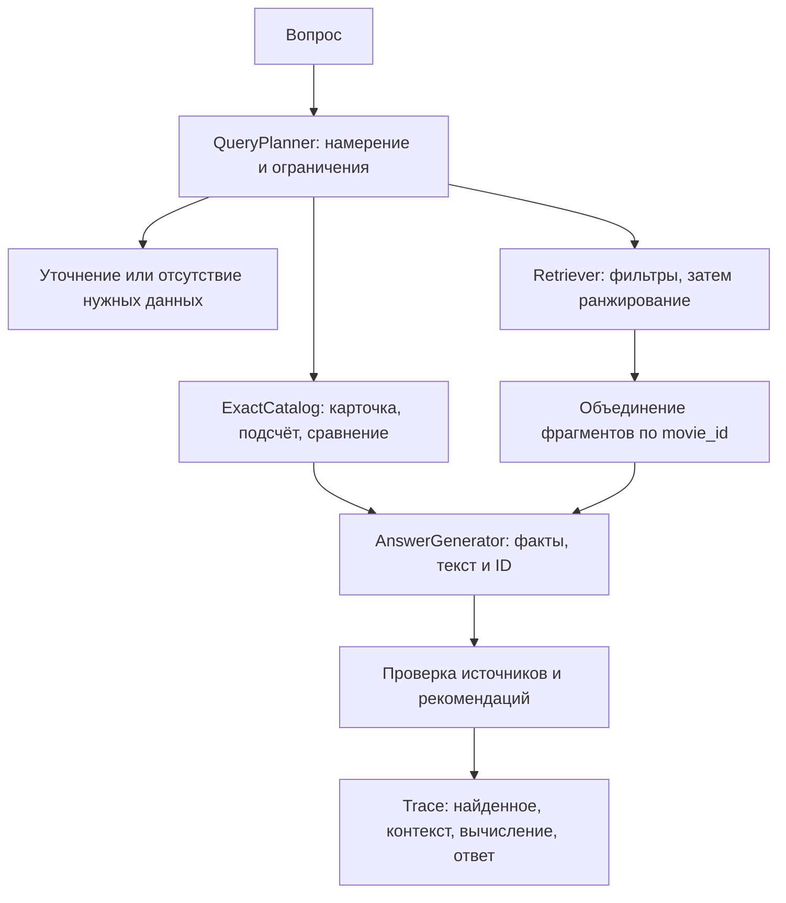

# Архитектура и границы реализации

## Основной поток

`domain.py` не зависит от SDK, сети или интерфейса пользователя. Сервисы
получают реализации протоколов через конструктор/аргументы. Новые провайдеры
размещаются в `adapters/` по мере реализации. Модуль сборки приложения
создаёт клиентов, читает настройки и связывает их с сервисами. CLI, HTTP и
пакетный evaluator должны использовать один `SearchService`.

Для поиска без генерации используется `RetrievalService.search`: он проверяет
фильтры, объединяет части по movie_id, отклоняет смешение ревизий и возвращает
`RetrievalResult` с исходными hits и `MovieMatch(film, chunks, score)`.
`SearchService` использует тот же сценарий для построения контекста, а CLI
только сериализует результат. Таким образом, дедупликация и проверки общие
для CLI, будущего API и RAG.

Первый адаптер `QdrantIndex` реализован поверх REST API Qdrant 1.17.
`QdrantHTTP` использует стандартную библиотеку Python; дополнительный SDK базы
не требуется. Поддерживаются фильтрация по метаданным и публикация полного
активного снимка. Использование pgvector потребует других адаптеров `Retriever`,
`IndexWriter` и, при необходимости, `ExactCatalog`; прикладной сценарий остаётся общим.

## Индекс и версии

`index_catalog` выбирает последнюю ревизию каждого `movie_id`, затем учитывает
`active`. Если последняя ревизия неактивна, старая не возвращается в индекс.
При повторной публикации удаляются и лишние части старой версии. Порт
`replace_snapshot` требует атомарной смены снимка: частичная загрузка не должна
становиться доступной поиску. Конкретный механизм реализуется в адаптере.

`Embedder.embed` возвращает `EmbeddingBatch`: векторы и неизменяемый
`EmbeddingIdentity` с моделью, ревизией, размерностью и параметрами кодирования.
Этот пакет передаётся через `index_catalog` в `IndexWriter.replace_snapshot`.
Адаптер сравнивает идентификатор производителя с моделью поиска до любых
обращений к БД; совпадения одной размерности недостаточно. Проверка действует
и для пустого снимка. Metadata берётся из проверенного пакета векторов.

`IndexWriter` возвращает `PublicationResult`, а `index_catalog` передаёт его
вызывающему коду. Тип содержит имя индекса, ID снимка, модель, fingerprint и
число фильмов/частей. CLI не обращается к изменяемому состоянию адаптера.
В Qdrant имя индекса соответствует alias, а ID снимка — физической коллекции.

Короткие описания сохраняются целиком. CLI использует `SentenceChunker`:
длинные описания разбиваются по предложениям с лимитом `CHUNK_CHARS`;
слишком длинные предложения — по словам. Каждая часть содержит исходную карточку;
`chunk_id` получает суффикс `:part-N`, а исходный `source_id` не меняется.
Embedding-текст всегда включает название и текст части.

Хранилище сохраняет ID карточки и части, movie_id, версию, active, название,
год, длительность, теги и текст. Векторный индекс дополнительно фиксирует имя
и ревизию embedding-модели, размерность и fingerprint каталога. Изменение
модели требует отдельного индекса и повторной индексации.

`QdrantIndex` создаёт физическую коллекцию `<alias>__<uuid>`, загружает все части
с `wait=true`, проверяет точное число точек и одним запросом меняет alias.
Пустой снимок публикуется так же, исключая все старые карточки. В metadata
коллекции записываются SHA-256 активного каталога и частей, число фильмов,
число частей и идентификатор модели. При поиске alias разрешается один раз:
проверка metadata и запрос относятся к одной физической коллекции.

Старые и незавершённые коллекции автоматически не удаляются: это сохраняет
читаемость снимка для уже начавшихся запросов и не удаляет новый индекс при
неоднозначном таймауте переключения. Для малого учебного каталога допустима
ручная очистка неиспользуемых коллекций. Длительно работающей системе потребуется
отдельная политика хранения. Публикацию выполняет один писатель; конкурентное
слияние изменений каталога в этот этап не входит.

`E5Embedder` скачивает конкретный commit `intfloat/multilingual-e5-small`,
регистрирует ONNX-модель в FastEmbed и использует префиксы `passage:` / `query:`.
Вместе с версией FastEmbed и ревизией весов это входит в идентификатор индекса;
несовпадение модели при поиске требует переиндексации. Каждый документ для
embedding содержит название. Вход длиннее 512 токенов отклоняется до inference,
поэтому конец описания не теряется из-за молчаливого усечения. Для необычно
длинных названий или текстов следует уменьшить `CHUNK_CHARS`.

В типизированном идентификаторе версия SDK называется `implementation_version`;
индексы с предыдущим полем `fastembed_version` требуют повторной публикации.

## План запроса и точные операции

Планировщик переводит вопрос в типизированный `QueryPlan`. Он не получает
`expected_status`, rubric или эталонные фильтры из `questions.jsonl`.
При отсутствии выбранного фильма «Сколько он длится?» требует уточнения.
Сведения об озвучивании, рейтингах и возрастных ограничениях отсутствуют в
схеме; запрос таких фактов завершается `insufficient`.

Это контракт следующего этапа: планировщик ещё не реализован. Текущий `search`
строит план из текста запроса и явных флагов CLI. Он не извлекает числовые
ограничения из естественного языка. Вывод разделён на `retrieved` и `movies`;
группировка не меняет оценки фрагментов и не генерирует объяснение рекомендации.

«Короче 90» даёт `< 90`, «не больше 90» — `<= 90`. Фильтры передаются
непосредственно поисковому адаптеру. При нарушении контракта сервис выдаёт
ошибку, поскольку удаление неподходящих результатов после top-k не возвращает
потерянных кандидатов. `retrieval_k` управляет числом частей, `context_movies`
— числом разных фильмов в контексте.

Для «Подойдёт ли Коралловая почта, если у меня 90 минут?» нужен
`COMPARE_DURATION`, выбранный movie_id и бюджет 90. Бюджет здесь не фильтр:
карточка с длительностью 96 должна попасть в контекст. `ExactCatalog`
вычисляет разницу 96 − 90 = 6. Для `COUNT` адаптер считает весь подходящий
набор, а не top-k. Нулевой подсчёт может иметь пустой список источников;
его основание — точная операция, сохранённая в трассе.

Для маленького каталога `ExactCatalog` можно реализовать поверх того же
проверенного JSON-снимка. Он обязан использовать ту же ревизию каталога,
что и индекс. Переход на SQL не меняет контракт.

## Ответы и сбои

Модель получает только выбранные карточки и их части, метаданные, источники
и результат точной операции. `validate_answer` проверяет существование ссылок,
названия, принадлежность источников рекомендациям и отсутствие дубликатов.
Это структурная проверка: смысловую подтверждённость каждого утверждения
по-прежнему проверяют инструкции генератора и оценщик.

`RetrievalUnavailable` обозначает недоступность хранилища. Адаптеры переводят
в неё таймауты и ошибки соединения. Транспорт должен возвращать такую ошибку
отдельно (например, HTTP 503), сохраняя три предметных статуса ответа.
Автоматическая подмена ошибки на `insufficient` запрещена.

## Эксперименты и оценка

Версии A и B создаются после подключения провайдеров. Сначала выполняется
реальный A, затем выбирается обнаруженная ошибка и меняется один элемент.
Конфигурации должны фиксировать модель, параметры поиска, версию prompt,
fingerprint каталога, индекс и изменённый элемент. Пустые конфигурации A/B
и вымышленные результаты в каркас не включены.

Сохранять `artifacts/<run-id>/manifest.json`, отдельный `<case-id>.json` с
полной `Trace`, решения оценщика и итоговые метрики. Технические ошибки
фиксировать в записи случая с типом ошибки; не исключать их молча из отчёта.
В секреты manifest не включать ключи API.

`recall_at_k` использует исходные source_id, даже если найдены части.
Для точного маршрута учитываются извлечённые карточки; случаи без эталонных
источников исключаются из среднего Recall@k. Отдельно считать долю ответов,
принятых по статусу, rubric, ограничениям и ссылкам. `SemanticJudge` допускает
ручную оценку или отдельную модель: одна совпавшая строка не доказывает
правильность ответа. Проверку строгих фильтров показывать отдельной метрикой
для случаев с ограничениями; проверять и поиск, и итоговые рекомендации.

`questions.jsonl` — набор из 10 предметных случаев, а `tests/` проверяет
контракты каркаса. Успех этих unit-тестов не означает прохождение RAG-оценки.

## Проверка этапа поиска

Локальные тесты проверяют запрос с фильтрами и top-k, подготовку публикации,
сбои, векторы, настройки и префиксы embeddings. `test_qdrant_live.py` содержит
включаемые проверки реального сервера и E5. В сессии разработки они пропущены:
установка из PyPI и доступ к Docker были заблокированы окружением. Прохождение
локальных тестов не подтверждает работу сервера, качество embeddings или A/B.

Контракты провайдеров сверены с первичными источниками:
[aliases Qdrant](https://qdrant.tech/documentation/manage-data/collections/),
[metadata коллекции](https://api.qdrant.tech/v-1-17-x/api-reference/collections/create-collection),
[FastEmbed](https://github.com/qdrant/fastembed),
[multilingual E5](https://huggingface.co/intfloat/multilingual-e5-small).

## Следующие шаги

1. Установить зависимости в `.venv`, запустить Compose и выполнить включаемые
   тесты реальной базы и модели, включая переход film-01 с 78 на 92.
2. Зафиксировать полный lock зависимостей после успешного разрешения и проверки
   на целевой версии Python; сейчас закреплена версия FastEmbed и ревизия весов.
3. Реализовать планировщик, точные операции и генератор структурированного ответа.
4. Добавить команды ask и evaluate с отдельным выводом найденного и ответа.
5. Провести A/B, сохранить смысловую оценку и разбор одной исправленной ошибки.

Hybrid-поиск реализуется новым `Retriever`; новые коллекции данных — загрузчиком;
смысловое разбиение — новым `Chunker`. Дополнительные слои и универсальные
фреймворки до появления такой потребности не требуются.
