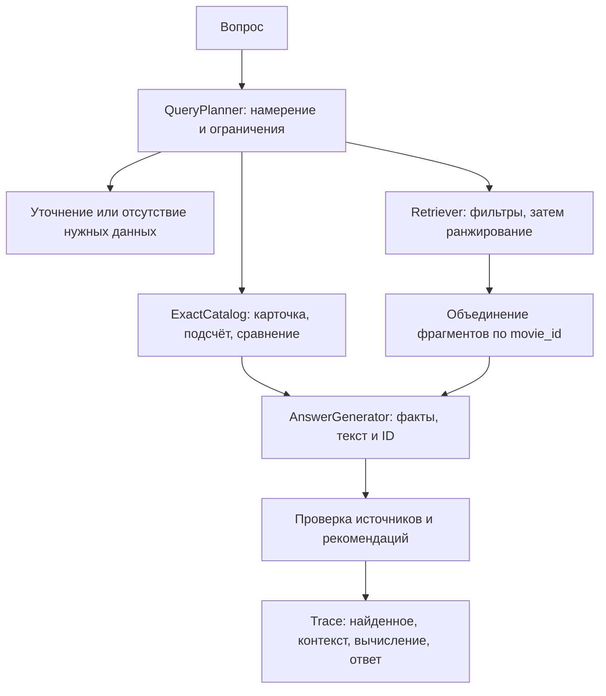

# Архитектура и границы реализации

## Основной поток

`domain.py` не зависит от SDK, сети или интерфейса пользователя. Сервисы
получают реализации протоколов через конструктор/аргументы. Новые провайдеры
размещаются в `adapters/` по мере реализации. Модуль сборки приложения
создаёт клиентов, читает настройки и связывает их с сервисами. CLI, HTTP и
пакетный evaluator должны использовать один `SearchService`.

Для поиска без генерации используется `RetrievalService.search`: он проверяет
фильтры, объединяет части по movie_id, отклоняет смешение ревизий и возвращает
`RetrievalResult` с исходными hits и `MovieMatch(film, chunks, score)`.
`SearchService` использует тот же сценарий для построения контекста, а CLI
только сериализует результат. Таким образом, дедупликация и проверки общие
для CLI, будущего API и RAG.

Первый адаптер `QdrantIndex` реализован поверх REST API Qdrant 1.17.
`QdrantHTTP` использует стандартную библиотеку Python; дополнительный SDK базы
не требуется. Поддерживаются фильтрация по метаданным и публикация полного
активного снимка. Использование pgvector потребует других адаптеров `Retriever`,
`IndexWriter` и, при необходимости, `ExactCatalog`; прикладной сценарий остаётся общим.

## Индекс и версии

`index_catalog` выбирает последнюю ревизию каждого `movie_id`, затем учитывает
`active`. Если последняя ревизия неактивна, старая не возвращается в индекс.
При повторной публикации удаляются и лишние части старой версии. Порт
`replace_snapshot` требует атомарной смены снимка: частичная загрузка не должна
становиться доступной поиску. Конкретный механизм реализуется в адаптере.

`Embedder.embed` возвращает `EmbeddingBatch`: векторы и неизменяемый
`EmbeddingIdentity` с моделью, ревизией, размерностью и параметрами кодирования.
Этот пакет передаётся через `index_catalog` в `IndexWriter.replace_snapshot`.
Адаптер сравнивает идентификатор производителя с моделью поиска до любых
обращений к БД; совпадения одной размерности недостаточно. Проверка действует
и для пустого снимка. Metadata берётся из проверенного пакета векторов.

`IndexWriter` возвращает `PublicationResult`, а `index_catalog` передаёт его
вызывающему коду. Тип содержит имя индекса, ID снимка, модель, fingerprint и
число фильмов/частей. CLI не обращается к изменяемому состоянию адаптера.
В Qdrant имя индекса соответствует alias, а ID снимка — физической коллекции.

Короткие описания сохраняются целиком. CLI использует `SentenceChunker`:
длинные описания разбиваются по предложениям с лимитом `CHUNK_CHARS`;
слишком длинные предложения — по словам. Каждая часть содержит исходную карточку;
`chunk_id` получает суффикс `:part-N`, а исходный `source_id` не меняется.
Embedding-текст всегда включает название и текст части.

Хранилище сохраняет ID карточки и части, movie_id, версию, active, название,
год, длительность, теги и текст. Векторный индекс дополнительно фиксирует имя
и ревизию embedding-модели, размерность и fingerprint каталога. Изменение
модели требует отдельного индекса и повторной индексации.

`QdrantIndex` создаёт физическую коллекцию `<alias>__<uuid>`, загружает все части
с `wait=true`, проверяет точное число точек и одним запросом меняет alias.
Пустой снимок публикуется так же, исключая все старые карточки. В metadata
коллекции записываются SHA-256 активного каталога и частей, число фильмов,
число частей и идентификатор модели. При поиске alias разрешается один раз:
проверка metadata и запрос относятся к одной физической коллекции.

Старые и незавершённые коллекции автоматически не удаляются: это сохраняет
читаемость снимка для уже начавшихся запросов и не удаляет новый индекс при
неоднозначном таймауте переключения. Для малого учебного каталога допустима
ручная очистка неиспользуемых коллекций. Длительно работающей системе потребуется
отдельная политика хранения. Публикацию выполняет один писатель; конкурентное
слияние изменений каталога в этот этап не входит.

`E5Embedder` скачивает конкретный commit `intfloat/multilingual-e5-small`,
регистрирует ONNX-модель в FastEmbed и использует префиксы `passage:` / `query:`.
Вместе с версией FastEmbed и ревизией весов это входит в идентификатор индекса;
несовпадение модели при поиске требует переиндексации. Каждый документ для
embedding содержит название. Вход длиннее 512 токенов отклоняется до inference,
поэтому конец описания не теряется из-за молчаливого усечения. Для необычно
длинных названий или текстов следует уменьшить `CHUNK_CHARS`.

В типизированном идентификаторе версия SDK называется `implementation_version`;
индексы с предыдущим полем `fastembed_version` требуют повторной публикации.

## План запроса и точные операции

Планировщик переводит вопрос в типизированный `QueryPlan`. Он не получает
`expected_status`, rubric или эталонные фильтры из `questions.jsonl`.
При отсутствии выбранного фильма «Сколько он длится?» требует уточнения.
Сведения об озвучивании, рейтингах и возрастных ограничениях отсутствуют в
схеме; запрос таких фактов завершается `insufficient`.

`adapters/rule_planner.py` реализует протокол `QueryPlanner` ограниченной
русскоязычной грамматикой `ru-rules-v1.1`. `build_planner` выбирает актуальные
активные карточки и передаёт адаптеру только отображение `movie_id → title`.
Планировщик не знает длительности, описания, теги, source_id или разметку оценки.
Он не вычисляет ответы и не решает, есть ли фильмы с заданной длительностью.

CLI `plan` загружает каталог и сериализует `QueryPlan`, не создавая embeddings
и клиент базы и не читая `.env`. Текущий `search` по-прежнему строит план
из явных флагов CLI. Вывод поиска разделён на `retrieved` и `movies`;
группировка не меняет оценки фрагментов и не генерирует объяснение рекомендации.

Поддерживаются целые минуты и несколько форм верхней границы; точные названия
сопоставляются по словам с нормализацией регистра и ё/е, без морфологии
и опечаток. Неизвестная ссылка в кавычках, несколько названий, нижняя граница,
дробь, часы, «до N», другие распознанные числовые условия и неоднозначный
бюджет дают `clarify`. Текст названий исключается из разбора условий:
число или слово «рейтинг» внутри названия не превращаются в фильтр или отказ.
Формы и примеры перечислены в README. Новые языковые конструкции требуют
расширения правил или отдельного адаптера планировщика.

Фразы запроса факта («сколько минут длится», «какова продолжительность
в минутах») исключаются из проверки неразобранных ограничений. Эта операция
не скрывает числовые условия: они разбираются и проверяются отдельно.
Ранний отказ по возрасту требует признаков допуска/ограничения/маркировки,
а не произвольного упоминания возраста в теме сюжета. Поддерживаются также
кавычки `„…“` для точного названия.

«Короче 90» даёт `< 90`, «не больше 90» — `<= 90`. Фильтры передаются
непосредственно поисковому адаптеру. При нарушении контракта сервис выдаёт
ошибку, поскольку удаление неподходящих результатов после top-k не возвращает
потерянных кандидатов. `retrieval_k` управляет числом частей, `context_movies`
— числом разных фильмов в контексте.

Для «Подойдёт ли Коралловая почта, если у меня 90 минут?» нужен
`COMPARE_DURATION`, выбранный movie_id и бюджет 90. Бюджет здесь не фильтр:
карточка с длительностью 96 должна попасть в контекст. `ExactCatalog`
вычисляет разницу 96 − 90 = 6. Для `COUNT` адаптер считает весь подходящий
набор, а не top-k. Нулевой подсчёт может иметь пустой список источников;
его основание — точная операция, сохранённая в трассе.

Планировщик допускает `COUNT` только для каталога целиком и его точных
ограничений длительности. Подсчёт «про море» требует уточнения: в текущем
`Filters` нет точного сюжетного предиката. При явном бюджете названного фильма
план содержит только `movie_ids` и `time_budget_minutes`, сохраняя длинную
карточку для сравнения. Общий бюджет открытой рекомендации становится `<= N`.
Команда `plan` только выбирает маршрут; `exact` выполняет его через
`execute_exact` и порт `ExactCatalog`. Общий сценарий `execute_exact`
также используется в `SearchService`: проверяет фильтры, уникальность фильмов
и принадлежность ссылок контексту.

`JsonExactCatalog` реализует порт поверх неизменяемого активного снимка.
`lookup` требует один movie_id и возвращает полную карточку, без синтетических
chunks. `COUNT` считает весь подходящий набор и возвращает его источники;
ноль — отдельный `ExactResult(0, "movies", ())`. Для `COMPARE_DURATION`
вычисляется signed-разница в минутах; отсутствующая карточка возвращает
пустой контекст и `None`, а не нулевую разницу. Бюджет должен быть положительным
целым; фильтры длительности в сравнении отклоняются, чтобы не спрятать карточку.

CLI `exact` загружает JSON один раз и передаёт те же ревизии планировщику
и каталогу. Изменение файла после создания адаптера не меняет его снимок.
В `build_rag` fingerprint этого снимка проверяется против metadata индекса
Qdrant. Офлайн-команда `exact` не использует индекс и не требует этой проверки.
Переход на SQL не меняет контракт порта.

`snapshots.py` задаёт общий канонический SHA-256: последние активные карточки,
сортировка по movie_id, стабильный JSON всех полей карточки. Формат совместим
с уже опубликованным индексом. `QdrantIndex.bind_snapshot` проверяет этот hash
и идентификатор embeddings, возвращая `PinnedQdrantRetriever`. Он хранит
физическую коллекцию, не разрешает alias заново и проверяет metadata перед
запросом. Новая публикация не смешивает старые JSON-факты с новыми векторами;
для перехода на новый снимок нужно создать новый сервис с актуальным JSON.

## Ответы и сбои

`GeminiAnswerGenerator` реализует `AnswerGenerator` через Gemini REST
`generateContent`: системные правила отдельно от JSON-данных вопроса, плана,
контекста и вычислений. Конфигурация запрашивает структурированный ответ
`generationConfig.responseFormat.text.schema`; модель по умолчанию —
`gemini-3.1-flash-lite`, prompt по умолчанию — `grounded-ru-v2`.
Версия v1 сохранена для повторения A. SDK не добавлен.
Строгий декодер отклоняет неверные типы/поля, затем используется общий
`validate_answer` для источников и рекомендаций. Это структурная, не смысловая
гарантия: приёмка по rubric и фактам остаётся отдельной задачей.

`build_rag` использует один активный JSON-снимок для планировщика и точного
каталога, а поиск закрепляет за совпадающей коллекцией. `ask` сначала проверяет
ранний статус без провайдеров; для остальных планов создаёт этот сервис.
В stdout — `Answer`, в необязательном `--trace` — полная `Trace` отдельно.
`GenerationUnavailable` обозначает HTTP/квоту, таймаут, блокировку или неполный
ответ Gemini; `SnapshotMismatch` — рассогласование каталогов. Они не становятся
`insufficient`. Автоматических повторов и переключений модели нет.
Исключения `http.client.HTTPException`, включая `IncompleteRead` при неполном
теле HTTP-ответа, тоже преобразуются в `GenerationUnavailable` на границе
Gemini HTTP-адаптера. CLI сохраняет обычный JSON ошибки и ненулевой код выхода.

Ключ Gemini отправляется только заголовком `x-goog-api-key`, скрыт из repr
настроек и не включается в prompt/трассы/ошибки. Бесплатность определяется
тарифом проекта Google; приложение тариф ключа автоматически не проверяет.
Проект должен оставаться Free Tier без подключённой оплаты.

Контракт REST и модель сверены с первичными источниками:
[структурированный JSON](https://ai.google.dev/gemini-api/docs/generate-content/structured-output),
[generateContent](https://ai.google.dev/api/generate-content),
[тарифы](https://ai.google.dev/gemini-api/docs/pricing).

Модель получает только выбранные карточки и их части, метаданные, источники
и результат точной операции. `validate_answer` проверяет существование ссылок,
названия, принадлежность источников рекомендациям и отсутствие дубликатов.
Это структурная проверка: смысловую подтверждённость каждого утверждения
по-прежнему проверяют инструкции генератора и оценщик.

`RetrievalUnavailable` обозначает недоступность хранилища. Адаптеры переводят
в неё таймауты и ошибки соединения. Транспорт должен возвращать такую ошибку
отдельно (например, HTTP 503), сохраняя три предметных статуса ответа.
Автоматическая подмена ошибки на `insufficient` запрещена.

## Эксперименты и оценка

Версии A и B создаются после подключения провайдеров. Сначала выполняется
реальный A, затем выбирается обнаруженная ошибка и меняется один элемент.
Конфигурации должны фиксировать модель, параметры поиска, версию prompt,
fingerprint каталога, индекс и изменённый элемент. Пустые конфигурации A/B
и вымышленные результаты в каркас не включены.

`experiments.run_evaluation` принимает порт `QuestionAnswerer`; в него
передаётся только строка вопроса, без эталонных данных. `build_rag_runtime`
возвращает сервис и whitelist метаданных: модель, prompt, embedding identity,
физическая коллекция, fingerprint и параметры. Настройки/адаптеры целиком
не сериализуются, ключей в manifest нет.

Подмена генератора требует явного `GeneratorIdentity` с моделью, версией prompt
и лимитом токенов. Это утверждение вызывающего кода о фактической конфигурации
объекта; фабрика не подставляет настройки штатного Gemini и не анализирует
внутреннее состояние произвольного адаптера. Контракт `AnswerGenerator`
остаётся независимым от метаданных. Одновременно передать подмену и отдельный
`prompt_version` нельзя: prompt настраивается на самом объекте.

`evaluate run` создаёт новый каталог и для каждого случая сохраняет case,
полную trace, найденные ID/части, контекст и ответ раздельно. Ошибка записывается
с типом; при 401/403/429 дальнейшие вызовы прекращаются, остальные случаи
получают `not_executed`. Сбой создания сервиса тоже архивируется. Полный состав
набора остаётся в знаменателях. Существующий каталог прогона не перезаписывается.

`ReviewedSemanticJudge` загружает решения с четырьмя явными проверками:
rubric, факты, ограничения и поддержка ссылок. Решение связывается хешами
со случаем/разметкой и конкретной trace. `evaluate score` сверяет архивы,
пересчитывает метрики и пишет отдельные judgment. Непроверенные ответы не
считаются принятыми: общая доля остаётся `null`, пока есть pending reviews.
Сам загрузчик не выполняет смысловую оценку: в A/B её сделал Codex после
просмотра всех ответов по исходным карточкам. Код и хеш решений скоринга
записываются отдельно от кода выполнения прогона.

`recall_at_k` использует исходные source_id, даже если найдены части.
Для точного маршрута учитываются извлечённые карточки; случаи без эталонных
источников исключаются из среднего Recall@k. Отдельно считать долю ответов,
принятых по статусу, rubric, ограничениям и ссылкам. `SemanticJudge` допускает
ручную оценку или отдельную модель: одна совпавшая строка не доказывает
правильность ответа. Проверку строгих фильтров показывать отдельной метрикой
для случаев с ограничениями; проверять и поиск, и итоговые рекомендации.
Проверяются также карточки, на которые ссылается обычный текст ответа.
Технические ошибки и невыполненные случаи дают нулевой вклад, а не исключаются.

`questions.jsonl` — набор из 10 предметных случаев, а `tests/` проверяет
контракты каркаса. Успех этих unit-тестов не означает прохождение RAG-оценки.

## Проверка этапа поиска

Локальные тесты проверяют запрос с фильтрами и top-k, подготовку публикации,
сбои, векторы, настройки и префиксы embeddings. `test_qdrant_live.py` содержит
включаемые проверки реального сервера и E5. 25 октября 2026 года все 41 тест
прошли без пропусков с Qdrant 1.17.0 и настоящей E5 на Python 3.13.15,
macOS arm64. Также выполнены CLI `index` и два примера `search` из README;
тестовые alias и коллекции удалены, основной индекс содержит 12 карточек.
Журнал и окружение: [проверка провайдеров](../artifacts/verification-2026-10-25/README.md).
Несколько семантических проверок не заменяют оценку полного RAG и A/B.

Контракты провайдеров сверены с первичными источниками:
[aliases Qdrant](https://qdrant.tech/documentation/manage-data/collections/),
[metadata коллекции](https://api.qdrant.tech/v-1-17-x/api-reference/collections/create-collection),
[FastEmbed](https://github.com/qdrant/fastembed),
[multilingual E5](https://huggingface.co/intfloat/multilingual-e5-small).

## Следующие шаги

Lock для CPython 3.13/macOS arm64 подготовлен и проверен чистой установкой:
29 внешних пакетов, включая setuptools, закреплены с хешами wheels.
Проект устанавливается отдельно без загрузки зависимостей и изоляции сборки.
Все 41 тест прошли без пропусков, включая Qdrant/E5; другие цели не проверены.
См. [зависимости](../requirements/README.md) и
[результаты](../artifacts/lock-verification-2026-10-25/README.md).

Первоначальная версия планировщика проверена отдельно и вместе с настоящим поиском: 63 теста прошли
без пропусков с Qdrant/E5; обычный локальный прогон — 60 прошли, 3 пропущены.
Для всех 10 исходных вопросов сохранены планы, без контекста и готовых ответов.
См. [проверку планировщика](../artifacts/planner-verification-2026-10-25/README.md).
После двух исправлений ревью в `ru-rules-v1.1` локально прошли 64 теста,
3 интеграционных пропущены. Маршруты проверены через `SearchService`;
настоящие Qdrant/E5 повторно не запускались.
См. [регрессионные проверки](../artifacts/planner-fixes-2026-10-25/README.md).

Точные операции реализованы и проверены: 21 новый тест, всего 85 прошли,
3 интеграционных пропущены. Проверены реальный JSON-каталог, планировщик,
CLI и передача точного результата в генератор-заглушку через `SearchService`.
См. [проверку точного каталога](../artifacts/exact-verification-2026-10-25/README.md).

Генератор и `ask` реализованы, согласованность снимков проверяется при сборке.
Все 106 тестов прошли с настоящими Qdrant/E5; Gemini в unit-тестах заменён
транспортной заглушкой. Отдельно прошли два реальных запроса Gemini и два ранних
ответа без модели. См. [сквозную проверку](../artifacts/rag-verification-2026-10-25/README.md).
После исправления HTTP-обрыва прошли 105 локальных тестов, 3 интеграционных
пропущены; провайдеры не вызывались повторно. Регрессия воспроизводится
на настоящем `HTTPResponse` и проверяется до уровня CLI.
См. [проверку транспорта](../artifacts/gemini-http-fix-2026-10-25/README.md).

`evaluate` реализован; выполнены реальные A/B по всем 10 случаям, по 7 запросов
Gemini на версию. Единственная смысловая правка — prompt v2 требует конкретный
способ разрешения сюжетной проблемы. В A отсутствовала роль радиопередачи
в ответе про щенка; в B она появилась в обосновании. Приёмка Codex: 9/10 → 10/10,
Recall@3 — 100%, фильтры — 100% в обоих. Планы, ID, контексты и вычисления
совпали. Все 123 теста прошли с настоящими Qdrant/E5.
См. [A/B-отчёт](ab-report.md) и [оценку](evaluation.md).

Базовое задание выполнено. Дальше возможны независимая смысловая проверка,
повторные прогоны для устойчивости и опциональные расширения задания.

Hybrid-поиск реализуется новым `Retriever`; новые коллекции данных — загрузчиком;
смысловое разбиение — новым `Chunker`. Дополнительные слои и универсальные
фреймворки до появления такой потребности не требуются.
