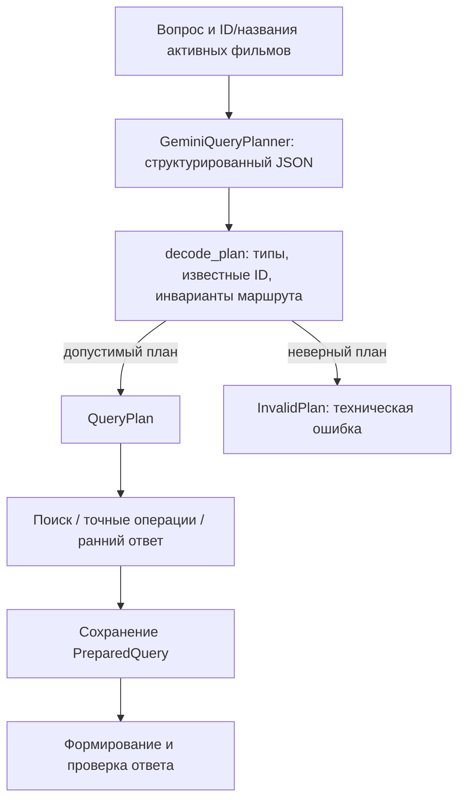

# LLM-планировщик: свободные формулировки в проверяемом плане

Добавлен отдельный режим `--planner-mode gemini` с текущей версией `gemini-plan-ru-v3`
(prompt `gemini-plan-ru-v3`, decoder `planner-decoder-v4`,
ранние объяснения `early-replies-ru-v2`).
По умолчанию остаётся `rules` / `ru-rules-v1.2.1`. Генератор ответа по-прежнему
`grounded-ru-v2`; его prompt в эксперименте не менялся.



Модель получает только исходный вопрос и пары movie_id/title. Сюжеты,
длительности, годы, source_id, ожидаемые ответы и rubric ей не передаются.
Structured Outputs задаёт схему; независимый декодер проверяет её ещё раз.
Поддержка JSON Schema и nullable-полей описана в
[документации Gemini](https://ai.google.dev/gemini-api/docs/structured-output).
Соответствие схеме не гарантирует правильного понимания вопроса — для этого
нужны эталоны маршрутов и смысловая оценка.

## Что расширено

Prompt позволяет понимать склонения, однозначные небольшие опечатки названий,
числа словами и часы вместо минут. Например, «меньше полутора часов» может
стать строгим `<90`, а «уложится ли фильм в полтора часа» — сравнением с
бюджетом 90. Это проверяется отдельными живыми случаями, а не выдаётся за
гарантию правильного разбора любых формулировок.

Текущий QueryPlan представляет верхние границы
длительности, границы года, выбор карточки, точный подсчёт и сравнение.
[Год, точный год и включительный диапазон](year-filters.md) поддерживаются
через year_gte/year_lte. Нижняя граница/диапазон длительности, дизъюнкция
и сюжетный подсчёт должны приводить к
уточнению; неизвестные факты вроде озвучивания — к insufficient. Модель
может ошибиться и молча потерять условие: декодер проверяет структуру, но
не доказывает смысловую эквивалентность плана исходному вопросу.

Декодер отклоняет неизвестные и повторяющиеся ID, лишние поля, bool/строки/
дроби вместо положительных целых минут, ранний answered, неизвестную причину раннего ответа и несогласованные
`early_reason`/`early_status`. При `clarify/insufficient`
после проверки типов и ID декодер очищает неисполняемые intent/query/filters/
budget и возвращает канонический ранний план. Неподдерживаемые поля схемы
по-прежнему отклоняются. Lookup/comparison требуют ровно одну активную
карточку. Сравнение не может фильтровать эту карточку по длительности;
только comparison несёт бюджет. Count запрещает semantic_query, чтобы
смысловой top-k не стал точным количеством.

Вопрос и названия отделены от системной инструкции. Это уменьшает возможность
подмены инструкций, но не доказывает устойчивости ко всем prompt injection.
Невалидный план не исполняется и не заменяется автоматически планом правил.

## Команды

Первые две команды ниже вызывают Gemini для планирования, даже когда готовый
ответ ещё не генерируется. Нужна настроенная `.env` с существующим ключом.
Планирование само по себе не требует Qdrant/E5.

```bash
PYTHONPATH=src .venv/bin/python -m cartoon_rag.cli plan \
  'Хочу мультфильм про море и дружбу, строго меньше полутора часов.' \
  --planner-mode gemini

PYTHONPATH=src .venv/bin/python -m cartoon_rag.cli exact \
  'Посчитай фильмы, которые идут меньше полутора часов.' --planner-mode gemini

PYTHONPATH=src .venv/bin/python -m cartoon_rag.cli ask \
  'Что происходит в «Маяке для кита»?' --planner-mode gemini

PYTHONPATH=src .venv/bin/python -m cartoon_rag.cli evaluate run \
  --planner-mode gemini --label llm-planner \
  --output /tmp/cartoon-llm-planner-run
```

`ask` использует один полученный план и не планирует вопрос повторно.
Обычный запрос требует одного дополнительного API-вызова; ранний статус тоже
нуждается в вызове планировщика. Ошибка API не означает отсутствие сведений.
Ошибки `prepare` и `answer` различаются в results.json; при сбое планировщика
свидетельств поиска ещё нет, при сбое ответа PreparedQuery сохраняется.
Ошибки 401/403/429 останавливают последующие случаи evaluator. Автоматических
повторов, переключения модели и изменений биллинга нет.

`evaluate run` пишет planner_mode/model/prompt_version/max_output_tokens
отдельно от идентификаторов генератора. `planner_renderer_version` фиксирует
версию шаблонов раннего ответа; хеши адаптера и early_replies.py входят в manifest.
Офлайн `evaluate stages` по-прежнему оценивает архивный план против эталона;
его `current_planner` повторяет **локальные правила**, не вызывает Gemini.
В отчёте stage-quality-v2 это явно указано как
`provenance.current_planner_mode=rules`. Для LLM нужно смотреть archived_planner,
а не считать локальный повтор правил повтором модели.

[Результаты реальных прогонов и ограничения](../artifacts/llm-planner-2026-11-12/README.md).


## Что не прошло проверку

В исходном прогоне v1 модель иногда угадывала карточку по словам сюжета
и выбирала lookup вместо поиска: whale, robot и dragon. Итоговый ответ мог
быть правильным, но проверка маршрута отклоняет такое поведение. На исходных
10 вопросах маршрут совпал с разметкой в 6 случаях, 3 не совпали, в одном
не было плана из-за 503. Это не доказательство улучшения планирования.

Декодер v1.1 устранил излишне строгий отказ от ранних планов с заполненными,
но неисполняемыми полями. В отдельном двухслучайном повторе оба запроса
завершились без технических ошибок, но текст про отсутствие года в каталоге
оказался неверным: year есть, хотя фильтр года не поддерживается. В этой архивной версии объяснения ранних ответов формировала модель;
декодер не гарантировал их фактическую правильность. Повтор дал 1/2 принятых ответов и не объединялся
с первым прогоном. Полные 10+8 случаев на v1.1 не перезапускались.


## Исправление объяснений в v2

Модель возвращает `early_reason` из перечисления вместо свободного `early_text`.
Provider-independent модуль `early_replies.py` связывает причину с допустимым
статусом и фиксированным русским текстом. Код проверяет наличие причины,
известное значение и соответствие статусу; неизвестная причина, противоречие
статусу или старое поле early_text отклоняются как InvalidPlan.
При обычном плане early_reason обязан быть null. С добавлением годовых
фильтров в v3 причина unsupported_year_filter удалена; остальные причины
и проверка соответствия статусу сохранены.

В предыдущем v2 `unsupported_year_filter` давал: «Данные о годе есть, но фильтрация по году
пока не реализована. Уточните запрос без этого условия». Отсутствие озвучивания,
рейтинга, возрастного допуска и биографии имеет отдельные причины и шаблоны;
неоднозначное название, отсутствие выбранного фильма, сюжетный подсчёт и
неподдерживаемые условия — свои уточнения. Свободные поля модели при раннем
ответе очищаются после проверки схемы и не становятся объяснением пользователю.

QueryPlan и исторический формат трасс сохраняют early_text — теперь в Gemini
v2 его заполняет только код. Поэтому старые архивы читаются как прежде и не
переписываются. Протокол ответов модели v2 изменён: старые JSON-кандидаты нужно
считать кандидатами прежней версии; адаптер v2 не принимает их как новые планы.
Правила по умолчанию и генерация обычных ответов не менялись.

Это устраняет свободную генерацию ранних объяснений, но не доказывает
правильность выбора причины моделью. Классификатор всё ещё может выбрать
неподходящий код; качество классификации требует отдельной проверки.
Проверка v2 выполнена локально с замоканным ответом планировщика. Новый реальный
Gemini-прогон не выполнялся, прежние цифры приёмки не пересчитывались.
Последующее добавление года проверено отдельно: [year-filters.md](year-filters.md).
[Регрессия и журнал](../artifacts/early-reply-templates-2026-11-12/README.md).


## Живая проверка текущего v3

После исправления операторов года все 190 тестов прошли с реальными Qdrant/E5.
Отдельно выполнено 13 Gemini-запросов к актуальным schema/prompt/decoder:
получено 12 планов, все 12 соответствуют эталонным маршрутам, фильтрам и
причинам. Один count-years завершился техническим сбоем без HTTP-статуса и
без плана; итог — 12/13, а не 13/13. Повторов не было.

В частности, «не раньше», «с» и «не ранее» дают >=1990, строгая граница —
>=1991, точный год и диапазон с <90 минут сохранены. Четыре кода early_reason
правильно выбраны и превращены кодом в шаблонные ответы. Из v3 не поступал
свободный early_text. Обычные ответы/рекомендации Gemini не генерировались;
это не новая A/B-приёмка. Ревью планов выполнено тем же Codex.
[Артефакты и воспроизведение](../artifacts/planner-v3-live-2026-11-12/README.md).


## Отдельный повтор тех же 13 случаев

Следующий прогон с теми же исходниками/вопросами/моделью получил все 13 планов
без технических ошибок. Оба точных подсчёта дали 20 и 7; все четыре early_reason
соответствуют эталону и превращены в шаблоны. Однако count-years добавил
верхнюю границу year_lte=9999, которой нет в запросе. На текущих данных число
20 не изменилось, но строгая проверка плана остаётся 12/13. Успешное вычисление
не заменяет проверку отсутствия дополнительных ограничений.

Первый результат 12/13 с одним техническим сбоем сохранён отдельно. Его нельзя
переписать результатами повтора или объявить единственным прогоном 13/13
по качеству планов. Qdrant/E5 и обычные ответы в повторе не запускались,
прикладной код не менялся. [Архив повтора](../artifacts/planner-v3-repeat-2026-11-12/README.md).
