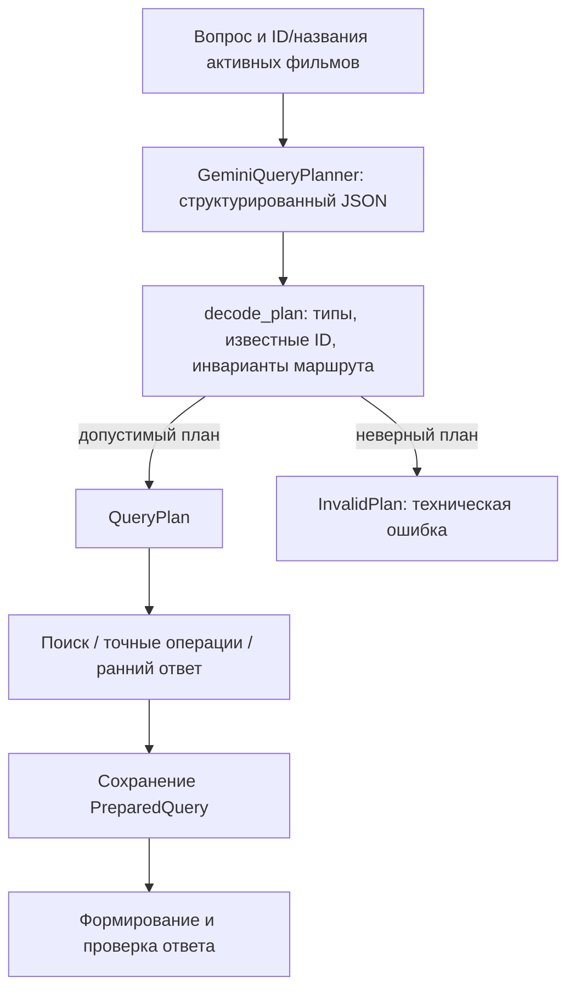

# LLM-планировщик: свободные формулировки в проверяемом плане

Добавлен отдельный режим `--planner-mode gemini` с текущей версией `gemini-plan-ru-v1.1`
(prompt `gemini-plan-ru-v1`, decoder `planner-decoder-v2`).
По умолчанию остаётся `rules` / `ru-rules-v1.1`. Генератор ответа по-прежнему
`grounded-ru-v2`; его prompt в эксперименте не менялся.



Модель получает только исходный вопрос и пары movie_id/title. Сюжеты,
длительности, годы, source_id, ожидаемые ответы и rubric ей не передаются.
Structured Outputs задаёт схему; независимый декодер проверяет её ещё раз.
Поддержка JSON Schema и nullable-полей описана в
[документации Gemini](https://ai.google.dev/gemini-api/docs/structured-output).
Соответствие схеме не гарантирует правильного понимания вопроса — для этого
нужны эталоны маршрутов и смысловая оценка.

## Что расширено

Prompt позволяет понимать склонения, однозначные небольшие опечатки названий,
числа словами и часы вместо минут. Например, «меньше полутора часов» может
стать строгим `<90`, а «уложится ли фильм в полтора часа» — сравнением с
бюджетом 90. Это проверяется отдельными живыми случаями, а не выдаётся за
гарантию правильного разбора любых формулировок.

При этом возможности QueryPlan не расширяются: представлены верхние границы
длительности, выбор карточки, точный подсчёт и сравнение. Нижняя граница,
диапазон, фильтр года, дизъюнкция и сюжетный подсчёт должны приводить к
уточнению; неизвестные факты вроде озвучивания — к insufficient. Модель
может ошибиться и молча потерять условие: декодер проверяет структуру, но
не доказывает смысловую эквивалентность плана исходному вопросу.

Декодер отклоняет неизвестные и повторяющиеся ID, лишние поля, bool/строки/
дроби вместо положительных целых минут, ранний answered и ранний ответ без объяснения. При `clarify/insufficient`
после проверки типов и ID декодер очищает неисполняемые intent/query/filters/
budget и возвращает канонический ранний план. Неподдерживаемые поля схемы
по-прежнему отклоняются. Lookup/comparison требуют ровно одну активную
карточку. Сравнение не может фильтровать эту карточку по длительности;
только comparison несёт бюджет. Count запрещает semantic_query, чтобы
смысловой top-k не стал точным количеством.

Вопрос и названия отделены от системной инструкции. Это уменьшает возможность
подмены инструкций, но не доказывает устойчивости ко всем prompt injection.
Невалидный план не исполняется и не заменяется автоматически планом правил.

## Команды

Первые две команды ниже вызывают Gemini для планирования, даже когда готовый
ответ ещё не генерируется. Нужна настроенная `.env` с существующим ключом.
Планирование само по себе не требует Qdrant/E5.

```bash
PYTHONPATH=src .venv/bin/python -m cartoon_rag.cli plan \
  'Хочу мультфильм про море и дружбу, строго меньше полутора часов.' \
  --planner-mode gemini

PYTHONPATH=src .venv/bin/python -m cartoon_rag.cli exact \
  'Посчитай фильмы, которые идут меньше полутора часов.' --planner-mode gemini

PYTHONPATH=src .venv/bin/python -m cartoon_rag.cli ask \
  'Что происходит в «Маяке для кита»?' --planner-mode gemini

PYTHONPATH=src .venv/bin/python -m cartoon_rag.cli evaluate run \
  --planner-mode gemini --label llm-planner \
  --output /tmp/cartoon-llm-planner-run
```

`ask` использует один полученный план и не планирует вопрос повторно.
Обычный запрос требует одного дополнительного API-вызова; ранний статус тоже
нуждается в вызове планировщика. Ошибка API не означает отсутствие сведений.
Ошибки `prepare` и `answer` различаются в results.json; при сбое планировщика
свидетельств поиска ещё нет, при сбое ответа PreparedQuery сохраняется.
Ошибки 401/403/429 останавливают последующие случаи evaluator. Автоматических
повторов, переключения модели и изменений биллинга нет.

`evaluate run` пишет planner_mode/model/prompt_version/max_output_tokens
отдельно от идентификаторов генератора. Хеш нового адаптера входит в manifest.
Офлайн `evaluate stages` по-прежнему оценивает архивный план против эталона;
его `current_planner` повторяет **локальные правила**, не вызывает Gemini.
В отчёте stage-quality-v1.3 это явно указано как
`provenance.current_planner_mode=rules`. Для LLM нужно смотреть archived_planner,
а не считать локальный повтор правил повтором модели.

[Результаты реальных прогонов и ограничения](../artifacts/llm-planner-2026-11-12/README.md).


## Что не прошло проверку

В исходном прогоне v1 модель иногда угадывала карточку по словам сюжета
и выбирала lookup вместо поиска: whale, robot и dragon. Итоговый ответ мог
быть правильным, но проверка маршрута отклоняет такое поведение. На исходных
10 вопросах маршрут совпал с разметкой в 6 случаях, 3 не совпали, в одном
не было плана из-за 503. Это не доказательство улучшения планирования.

Декодер v1.1 устранил излишне строгий отказ от ранних планов с заполненными,
но неисполняемыми полями. В отдельном двухслучайном повторе оба запроса
завершились без технических ошибок, но текст про отсутствие года в каталоге
оказался неверным: year есть, хотя фильтр года не поддерживается. Объяснения
ранних ответов пока формирует модель; их фактическая правильность не
гарантирована декодером. Повтор дал 1/2 принятых ответов и не объединялся
с первым прогоном. Полные 10+8 случаев на v1.1 не перезапускались.
