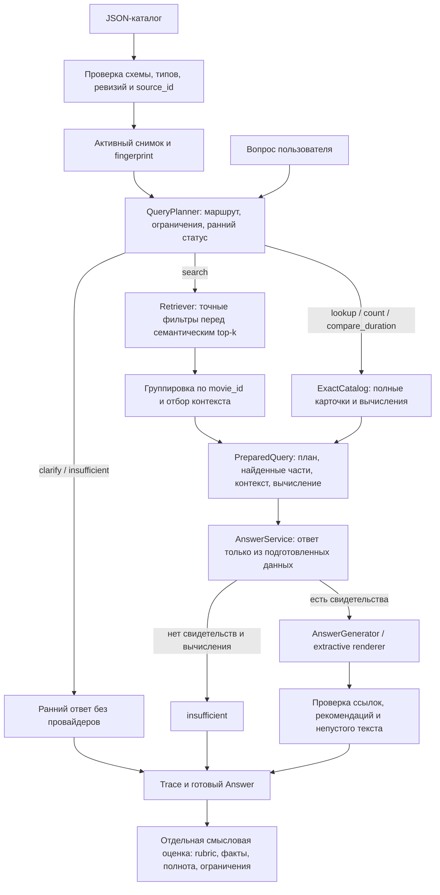

# От вопроса к ответу: этапы и проверка качества



`SearchService.prepare()` ищет фильмы и готовит свидетельства. Для смыслового
поиска `RetrievalService` возвращает части и фильмы без повторов. Для точных
операций `JsonExactCatalog` использует весь активный каталог; count не зависит
от top-k. При сборке RAG fingerprint каталога сравнивается с индексом.

`AnswerService.answer(prepared)` формирует ответ и проверяет его контракт.
У сервиса есть только генератор: он не может самостоятельно вызвать поиск или
подменить выбранный снимок. `SearchService.answer()` делегирует ему работу,
сохраняя прежний интерфейс. При оценке `PreparedQuery` записывается на диск
до генерации, поэтому отказ модели не стирает свидетельства поиска.

Здесь поиск ответа означает формирование ответа из найденных карточек.
Отдельного второго векторного индекса ответов нет. Для коротких описаний
используются исходные части; в extractive-режиме модель выбирает цитаты.

## Маршрут запроса и статус ответа

Это две отдельные проверки. Маршрут `search` ищет подходящие фильмы,
`lookup` получает названную карточку, `count` считает, `compare_duration`
вычисляет разницу с бюджетом. `lookup` может отвечать и на сюжетный вопрос:
он не означает исключительно запрос длительности.

Статус готового ответа: `answered` — есть подтверждённый ответ,
`insufficient` — нужных сведений недостаточно, `clarify` — нужно уточнение.
Планировщик может заранее выбрать последние два статуса. Обычный `search`
тоже может закончиться `insufficient`, если свидетельства не найдены.
Сбой БД или модели остаётся технической ошибкой и не получает такой статус.
По умолчанию используется ограниченная грамматика правил; опциональный
[LLM-планировщик](llm-planner.md) расширяет понимание формулировок.
Универсальная классификация естественного языка не заявляется.

## Проверка каталога при загрузке

`load_catalog()` проверяет JSON-массив объектов, обязательные и неизвестные
поля, повторяющиеся ключи JSON. В `Film` проверяются непустые строковые поля,
положительные целые year/duration_minutes/version, настоящий boolean active,
строковые непустые теги. Boolean не принимается вместо целого числа.
После чтения проверяются повторные пары movie_id/version и уникальность
source_id активных карточек. Ошибки строки содержат её номер.

Последняя неактивная версия удаляет фильм из активного снимка; старые версии
не восстанавливаются. Пустой каталог поддерживается для пустого снимка.
Проверка схемы не подтверждает правдивость сюжета: каталог остаётся единственным
источником фактов. Правила типов действуют также при создании Film адаптерами.

## Отдельные метрики

Команда `evaluate stages` читает архив и проверяет его хеши и привязки
смысловых решений, ничего в нём не меняя. Дополнительная ручная разметка
[data/stage-expectations-v1.json](../data/stage-expectations-v1.json) содержит
ожидаемые маршруты, фильтры, бюджет, ранние статусы и точный результат для
10 исходных вопросов. Она привязана к SHA-256 набора случаев и каталога.
Исходные questions.jsonl и catalog.json сохранены.

| Этап | Проверка |
| --- | --- |
| Планирование | Архивный план против разметки; отдельно повтор текущего планировщика на тех же вопросах |
| Поиск | Recall@k исходных source_id по сырым top-k; строгие фильтры всех найденных частей |
| Отбор контекста | Полнота эталонных source_id после отбора; фильтры контекста; совпадение карточек с каталогом и принадлежность вложенных фрагментов родительской карточке |
| Вычисление | Точные value/unit/source_ids для count/compare против ручного эталона; lookup проверяется через контекст |
| Тип результата | Итоговый status против expected_status независимо от маршрута |
| Контракт ответа | Источники, рекомендации, текст; повреждённый архив отклоняется до отчёта |
| Смысл ответа | Уже сохранённое решение оценщика по rubric, фактам, полноте и ссылкам |
| Сквозной исход | Завершение и полная приёмка отдельно от качества предыдущих этапов |

Для каждой метрики есть pass/fail/missing/not_applicable, число применимых и
проверенных случаев, `coverage` и среднее по наблюдаемым проверкам
`observed_mean`. Это среднее нельзя выдавать за сквозную приёмку при неполном
покрытии. Отсутствие ответа после 503 даёт missing в проверке ответа и fail
в completion; сохранённый поиск оценивается отдельно. Пустой поиск без
эталонных источников не доказывает смыслового отсутствия фильма.

Текущая базовая разметка проверяет одну точную операцию — сравнение.
Count/lookup дополнительно покрыты локальными тестами; отдельной смысловой
статистики по ним этот отчёт не создаёт. Recall измеряет попадание источника,
а не достаточность каждого фрагмента для ответа. Полноту и поддержку всех
утверждений проверяет смысловой оценщик, а не совпадение строк.

## Воспроизведение

Из корня проекта, без чтения .env, E5, Qdrant и Gemini:

```bash
PYTHONPATH=src .venv/bin/python -m unittest discover -s tests -v
PYTHONPATH=src .venv/bin/python -m cartoon_rag.cli validate-data
PYTHONPATH=src .venv/bin/python -m cartoon_rag.cli evaluate stages \
  --run-dir artifacts/ab-A-2026-10-25 \
  --expectations data/stage-expectations-v1.json \
  --reviews artifacts/ab-A-2026-10-25/reviews.json \
  --output /tmp/cartoon-stages-A.json
```

Для B замените A на B в путях архива, reviews и выходного файла. Выходной файл
должен отсутствовать: отчёт не перезаписывает существующий файл. При той же
версии Python, коде и входных файлах JSON-результат повторяется без новых
модельных запросов. Версия отчёта — stage-quality-v2, разметки — baseline-stages-v1;
сохраняются хеши исходников, каталога, архива, результатов и решений оценщика.
В новых `evaluate run` дополнительно сохраняются Python/platform, версии
FastEmbed/ONNX Runtime/tokenizers/NumPy и хеши загрузчика, точного адаптера,
настроек, fingerprint и embedding-адаптера. Старым архивам эти данные не
приписываются. Новые архивы имеют формат 3 с годовыми границами; старые метрики схем 1/2
сохранены. Для новых прогонов исходных вопросов берите stage-expectations-v2.json;
приведённый выше разбор старых A/B использует прежний stage-expectations-v1.json.

Это воспроизводимость оценки сохранённых ответов. Новый сетевой прогон LLM
может дать другой текст или ошибку даже при одинаковом prompt. Для нового
эксперимента нужен отдельный каталог артефактов и разрешение на вызовы Gemini.

[Проверенные результаты и ограничения](../artifacts/stage-quality-context-fix-2026-11-11/README.md).
